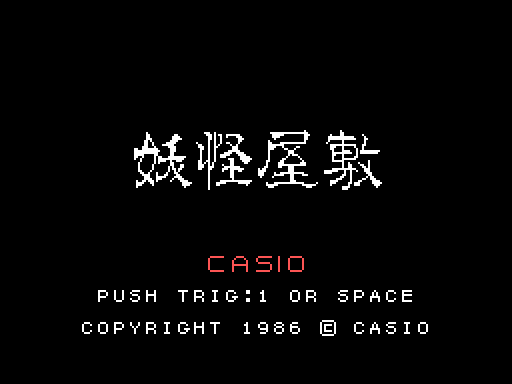
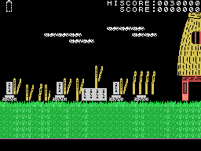
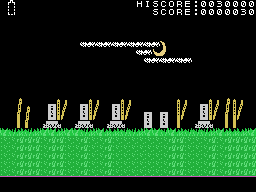

# The game

*Youkai Yashiki* (妖怪屋敷, "the y&#333;kai mansion") is a platform game. The hero goes through five places -from
the graveyard to the mansion- screen by screen, jumping, climbing ladders and throwing his weapon at the y&#333;kai;
each place ends when he beats the event that guards it. The places, in [The places](THE-PLACES.html).

Every GIF on this site is the ROM **running in openMSX** (a Japanese MSX1 with C-BIOS, at 60 frames per second): on
every frame the VRAM, the RAM and the VDP registers are logged, and `tools/vdp.py` paints them. The game ones are
played by a simple pilot (`tools/guiones/piloto.tcl`): it walks one way and the other, throws the weapon and jumps
every so often.

## The intro and the title

Four CASIO come in from the sides and meet, with SOFTWARE underneath. The title puts up the name (妖怪屋敷, four rows
of 16 tiles), CASIO, PUSH TRIG:1 OR SPACE and the copyright. After 240 frames without touching anything the **demo**
starts, in the graveyard; its controls are read from address 0x0000 (see [Curiosities](CURIOSITIES.html)).

## The controls

| | joystick | keyboard |
|---|---|---|
| walk and climb ladders | joystick 1 | the cursors |
| throw the weapon | button 1 | the space bar |
| jump | button 2 | GRAPH |
| pause | | STOP |
| give up | | F1 |

**The weapon** goes out to the side the hero faces, 4 pixels per frame: with full endurance it reaches the edge;
otherwise, only five frames (`ataque`, 0x85BD). **The jump** follows a table of heights, straight or to one side
(0x8F91 and 0x8FA2). With no ground below, he falls (`caida`, 0x86E7).

## The lives and the endurance

The hero has **three lives** (0xE0A8). At the top left his **endurance** (0xE0A9) is painted, in half tiles, up to
two per life: what he picks up raises it and every blow from a y&#333;kai takes half (`golpe`, 0xB146). With no
endurance, a blow brings him down and he loses a life; with no lives, GAME OVER. The game starts with no endurance.

## The points

The scoreboard at the top has HISCORE and SCORE with seven digits; the high score starts at 30,000.
