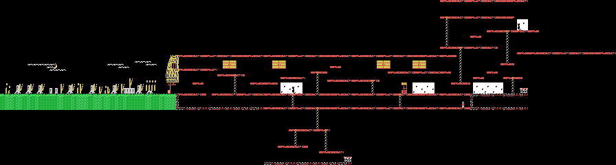
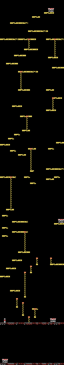
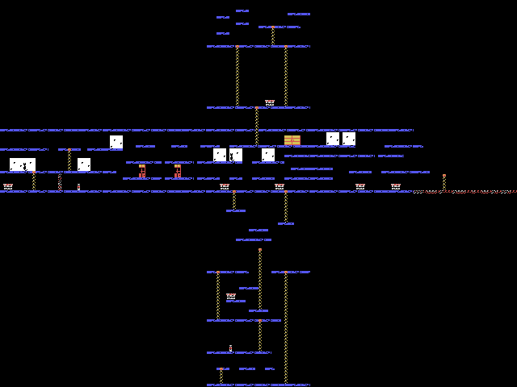
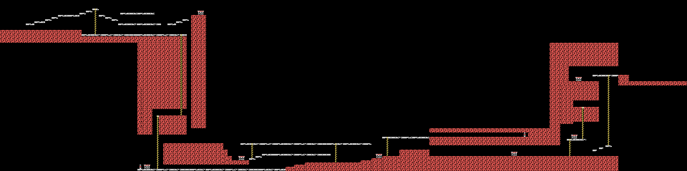
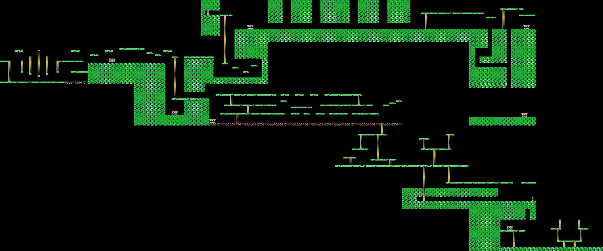
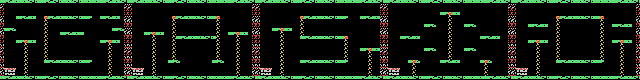
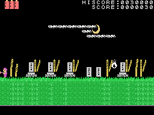
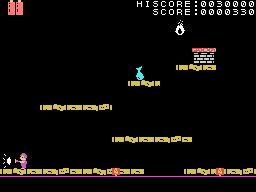
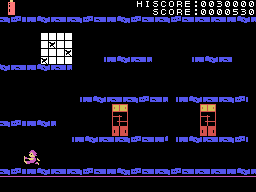
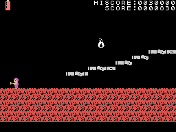

# The places

Five places (0xE00A, 0 to 4), each with its **map**: rows of ten cells with the number of the screen in each spot
(0x4038). In all, **74 screens** of 32 x 20 tiles, each with its description (0x41AC: pieces, fills, ladders and
drawings) and its list of y&#333;kai and objects (0x4EBE). One goes from one to another by the edges -the new one
slides in from that side-, by the ladders and by the doors, which lead to another place (0xA0D7: the place, the
column and the row of the destination).

The y&#333;kai (0xE340, up to twelve) are of 23 types: some wait and jump, others walk, fly or fall; the objects
(0xE400) are what can be picked up, doors and decorations.

With the five keys on the title (full endurance and blows do not take it, see [Curiosities](CURIOSITIES.html)), the
pilot against the y&#333;kai of the graveyard:

## The plans

All six places, whole, each screen in its spot on the plan (0x4038), at half size. They are **drawn by running the
ROM** (`tools/mapas.py`): each screen is built by `pantalla_monta` (0x9257) in RAM, over the tiles of a recorded frame
of its place; the tiles are the same everywhere and only the colour of 0x41-0x47 changes (`sala_colores`, 0x8206). No
scoreboard, sprites or the objects that are drawn separately.

The plan holds **a sixth place** (number 5, screens 0x45-0x49), reached by doors 28 to 32 of the table at 0xA0D7, that
no recording has visited: it is drawn with the tiles of place 4, which is the colour `sala_colores` gives it. And four
screens, 0x13 to 0x16, are on no plan at all.

Check: of the 69 screens on the plans, the recordings only go through 7; 3 come out **identical** to the recorded name
table and the other four with 4 to 31 differing tiles out of 640 (the objects). On 4,012 of 4,050 recorded frames (one in
seven), the screen `pantalla_monta` builds here is the same one the game holds in RAM; of the 38 that are not, 29 are
on the first screen, and they have not been looked at one by one.

## The events

Each place has its **event** (`sala_suceso`, 0x8252): a large drawing that appears on a given screen (the one at
0x852E for each place) with its y&#333;kai, and that has to be beaten:

| place | the event |
|---|---|
| 0 | the drawing at 0x7700; six blows of the weapon on its spot |
| 1 | the one at 0x7780 and two y&#333;kai of type 0x10; ten blows |
| 2 | the one at 0x7740 and two of type 0x11; reaching its spot |
| 3 | the one at 0x77C0 and three y&#333;kai (0x12 and 0x13); five blows |
| 4 | two y&#333;kai (0x15 and 0x16); four blows: the ending is set going (0xE047) |

Once beaten, tune 7 plays, two sprites go up and the place is over: the endurance fills up and the next one starts;
after 4, place 0 again with one more round (0xE009).

**The ending**: with the mark of place 4 and certain objects picked up (0xE048, 0xE049 and 0xE04A = 2), a character
appears (the y&#333;kai of type 11, 0xA778) and walks to the right; on reaching it, a text comes up (0xA839 and
0xA846) and tune 3. No recording got that far: this comes from the code.

## The places, forced

The GIFs of places 1 to 4 are **forced**: the place put by hand (0xE00A) and F1, so that the hero falls and the place
starts again, now the new one. The pilot plays with the title keys.

