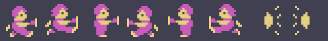
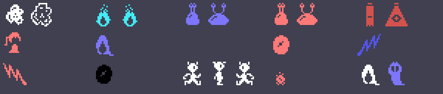
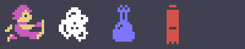

# The sprites

Everything on this page is **put together from the ROM tables** with `tools/hojas.py`: the drawings are the 0x800
bytes at 0x5800 that `sprites_dibujos` (0xB36D) puts as they are at 0x3800, and every figure is built with the
drawings and colours the code gives it. Each thing is made of 16-byte sprites from 0xE300 (the first 4, its
attributes): the hero at 0xE300 and 0xE310, his weapon at 0xE320 and the twelve enemies from 0xE340 (+4 the type, by
the table at 0xA1E8). None of these images is a screenshot.

**Checked against openMSX** on the recordings of this site:

- the sprite drawing table (VRAM 0x3800-0x3FFF) is **identical** to the game's on 35,858 frames (4 more catch the
  copy halfway);
- the hero's two sprites, in the same place with the drawing and the drawing + 0x60 in light yellow, on **26,999
  frames, 0 different** (123 more still at zero);
- the weapon, 0x28 or 0x2C, on **13,221 frames, 0 different**;
- the enemies carry one of the drawings (or the next one, + 4) and one of the colours their code gives them on
  14,615 frames; **11 unexplained**. The enemy routines are not named in the listing, so this check does not go type
  by type.

## The hero and his weapon

Two sprites in the same place: the drawing in magenta and the drawing + 0x60 in light yellow (`sala_empieza` 0x806D,
`caida_para` 0x87A3). Standing 0x0C or 0x14 by his side (0x880D), and walking 0x08 to 0x1C. Then the weapon
(`ataque_sale`, 0xE320): 0x28 to the right and 0x2C to the left, which goes out 4 dots per frame:

## The ghosts

The drawings and colours the enemy routines (0xA216-0xAD85) put in their sprite, each with the next one (+ 4) when
they change it: 0x38 / 0x3C in white while they wait (0xA216), 0x30 in cyan (0xAAE8), 0x4C in light blue or light red
(0xA451, 0xA457), 0x88 and 0x9C in dark red (0xA4E3), 0xF8 in light red (0xA7A3), 0xAC in light blue (0xAB20), 0xE4
in light yellow (0xABE9), 0x40 in light red (0xABF9) or black (0xAD81), 0xB8 in dark blue (0xAC18), 0xA8 in light
red (0xAC90), 0xD4-0xE0 in white (0xA884) and 0xA4 in light red (0xA60A); at the end, the two that appear when a room
is beaten (`suceso_vencido`: 0xAC and 0xB0):

The hero walking and some ghosts with their two drawings, at the game's pace:

