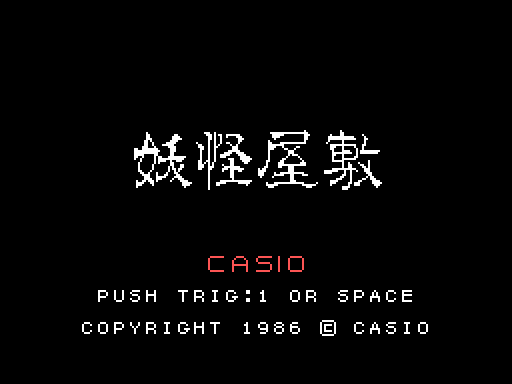
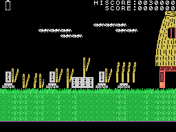
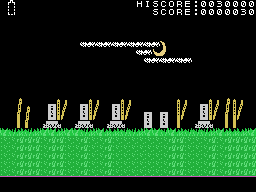

# La partida

*Youkai Yashiki* (妖怪屋敷, "la mansi&oacute;n de los y&#333;kai") es un juego de plataformas. El protagonista
recorre cinco lugares -del cementerio a la mansi&oacute;n- de pantalla en pantalla, saltando, subiendo escaleras y
lanzando su arma contra los y&#333;kai; cada lugar acaba cuando vence al suceso que lo guarda. Los lugares, en [Los
lugares](LOS-LUGARES.html).

Cada GIF de esta web es la ROM **funcionando en openMSX** (un MSX1 japon&eacute;s con C-BIOS, a 60 cuadros por
segundo): en cada cuadro se apuntan la VRAM, la RAM y los registros del VDP, y `tools/vdp.py` los pinta. Los de la
partida los juega un piloto sencillo (`tools/guiones/piloto.tcl`): anda a un lado y a otro, lanza el arma y salta
cada poco.

## La presentaci&oacute;n y el t&iacute;tulo

Cuatro CASIO entran por los lados y se juntan, con SOFTWARE debajo. El t&iacute;tulo pone el nombre (妖怪屋敷,
cuatro filas de 16 casillas), CASIO, PUSH TRIG:1 OR SPACE y el copyright. A los 240 cuadros sin tocar nada empieza
la **demostraci&oacute;n**, en el cementerio; sus mandos se leen desde la direcci&oacute;n 0x0000 (ver
[Curiosidades](CURIOSIDADES.html)).

## Los mandos

| | mando | teclado |
|---|---|---|
| andar y subir escaleras | mando 1 | los cursores |
| lanzar el arma | bot&oacute;n 1 | la barra |
| saltar | bot&oacute;n 2 | GRAPH |
| pausa | | STOP |
| rendirse | | F1 |

**El arma** sale hacia el lado al que mira el protagonista, 4 p&iacute;xeles por cuadro: con el aguante lleno llega
hasta el borde; si no, solo cinco cuadros (`ataque`, 0x85BD). **El salto** sigue una tabla de alturas, recto o hacia
un lado (0x8F91 y 0x8FA2). Sin suelo debajo, cae (`caida`, 0x86E7).

## Las vidas y el aguante

El protagonista tiene **tres vidas** (0xE0A8). Arriba a la izquierda se pinta su **aguante** (0xE0A9), en medias
casillas, hasta dos por vida: lo que recoge lo sube y cada golpe de un y&#333;kai quita medio (`golpe`, 0xB146). Sin
aguante, un golpe lo derriba y pierde una vida; sin vidas, GAME OVER. La partida empieza con el aguante a cero.

## Los puntos

El marcador de arriba lleva HISCORE y SCORE con siete cifras; el r&eacute;cord empieza en 30.000.
