# Los lugares

Cinco lugares (0xE00A, de 0 a 4), cada uno con su **plano**: filas de diez casillas con el n&uacute;mero de la
pantalla que hay en cada sitio (0x4038). En total, **74 pantallas** de 32 x 20 casillas, cada una con su
descripci&oacute;n (0x41AC: piezas, rellenos, escaleras y dibujos) y su lista de y&#333;kai y objetos (0x4EBE). Se
pasa de una a otra por los bordes -la nueva entra desliz&aacute;ndose por ese lado-, por las escaleras y por las
puertas, que llevan a otro lugar (0xA0D7: el lugar, la columna y la fila de destino).

Los y&#333;kai (0xE340, hasta doce) son de 23 tipos: unos esperan y saltan, otros andan, vuelan o caen; los objetos
(0xE400) son lo que se coge, puertas y adornos.

Con las cinco teclas del t&iacute;tulo (el aguante lleno y los golpes no lo quitan, ver
[Curiosidades](CURIOSIDADES.html)), el piloto contra los y&#333;kai del cementerio:

## Los planos

Los seis lugares enteros, con cada pantalla en su sitio del plano (0x4038), a la mitad de tamaño. Están **pintados
ejecutando la ROM** (`tools/mapas.py`): cada pantalla la monta `pantalla_monta` (0x9257) en la RAM, sobre las
casillas de un cuadro grabado de su lugar; las casillas son las mismas en todos y solo cambia el color de las
0x41-0x47 (`sala_colores`, 0x8206). Sin marcador, sprites ni los objetos que se pintan aparte.

El plano tiene **un sexto lugar** (el 5, con las pantallas 0x45-0x49) al que llevan las puertas 28 a 32 de la tabla
de 0xA0D7, y que ninguna grabación ha visitado: se pinta con las casillas del lugar 4, que es el color que le da
`sala_colores`. Y cuatro pantallas, de la 0x13 a la 0x16, no están en ningún plano.

Cotejo: de las 69 pantallas de los planos, las grabaciones solo pasan por 7; 3 salen **iguales** a la tabla de nombres
grabada y las otras cuatro con entre 4 y 31 casillas distintas de 640 (los objetos). En 4.012 de 4.050 cuadros grabados (uno
de cada siete), la pantalla que monta `pantalla_monta` aquí es la misma que tiene el juego en su RAM; de los 38 que
no, 29 son de la primera pantalla, y no se han mirado uno a uno.

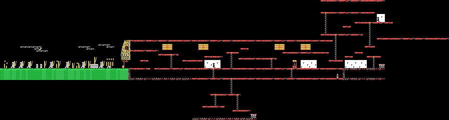

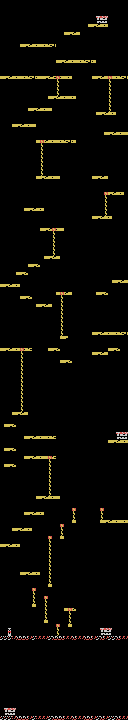

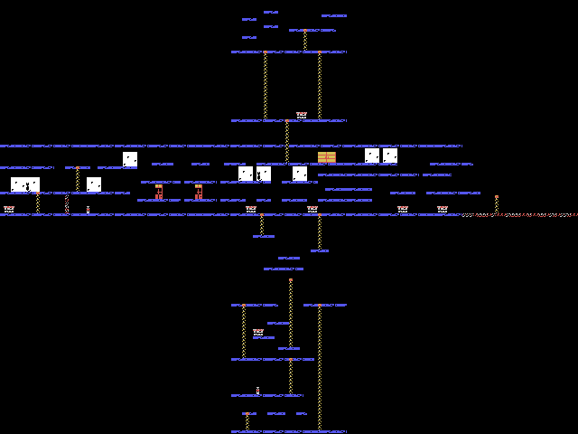

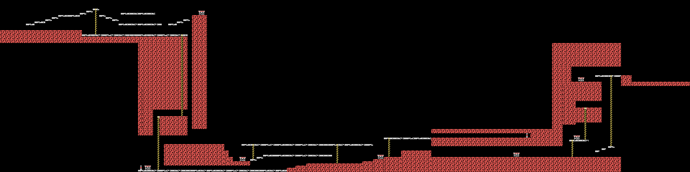

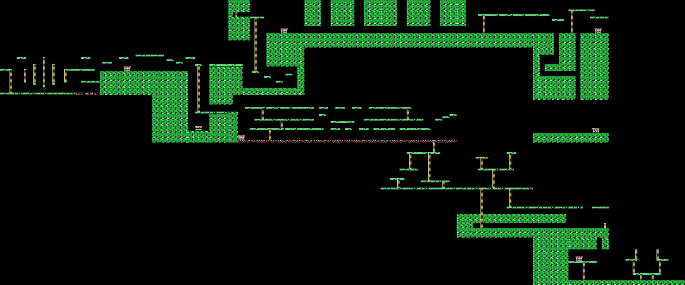

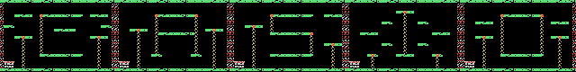

## Los sucesos (los jefes)

Cada lugar tiene su **suceso** (`sala_suceso`, 0x8252), su jefe. Est&aacute; en la pantalla de 0x852E para el lugar
(0x09, 0x12, 0x1E, 0x2F y 0x44), y esa pantalla solo deja pasar al protagonista con 0xE046 mayor que el lugar
(`sala_puerta_mira`, 0x88E9); 0xE046 sube uno cada cinco de ciertos objetos cogidos (`cosa_coge`, 0x977C). Pasada la X
0x28, `dibujo_suceso` (0x84DF) carga 0x2C0 bytes de dibujos en las casillas 0x90 de los tres tercios (de 0x6800,
0x6C00, 0x6A80, 0x6B80 y otra vez 0x6B80, con sus colores 0x1000 m&aacute;s all&aacute;) y la rutina del suceso pone su
dibujo grande, de 8 x 8 casillas, y sus y&#333;kai:

| lugar | pantalla | el suceso | c&oacute;mo se vence |
|---|---|---|---|
| 0 | 0x09 | el dibujo de 0x7700 (fila 10, columna 15): una cara con el pelo largo; el pelo son los cinco objetos del tipo 0x13 de la pantalla, pintados despu&eacute;s | seis golpes del arma en su sitio (X 0x88-0x97, Y 0x48-0x8F); acercarse aparta al protagonista 0x20; volver por debajo de la X 0x20 lo borra |
| 1 | 0x12 | el de 0x7780 (fila 13): una calavera con cuernos, y dos y&#333;kai del tipo 0x10, los rayos que salen de sus ojos | diez golpes a los rayos |
| 2 | 0x1E | el de 0x7740 (fila 13): un capullo colgado de un &aacute;rbol, y dos del tipo 0x11 | llegar a su sitio (Y 0x68-0x77, X 0x88-0x97); andando por debajo de la Y 0x71 aparta al protagonista |
| 3 | 0x2F | el de 0x77C0 (fila 12): un ojo rojo grande, dos ojos del tipo 0x12 y la pupila, tipo 0x13 | cinco golpes a la pupila |
| 4 | 0x44 | sin dibujo: dos y&#333;kai, 0x15 y 0x16, una llama sobre un fantasma en cada esquina de arriba | cuatro golpes: el final se pone en marcha (0xE047 = 1) |

Cada uno **pintado ejecutando la ROM** (`tools/jefes.py`): sobre el cuadro grabado justo antes de que salga, se
ejecuta `sala_suceso` en `tools/bios.py`; la zona de juego, sin sprites (ni el pelo del 0, que lo pintan despu&eacute;s los objetos). Cotejo: la tabla de nombres, los dibujos y
colores de las casillas y los tipos de sus y&#333;kai salen **id&eacute;nticos** a los grabados en los 5 sucesos.

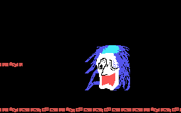

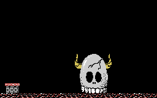

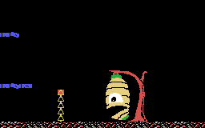

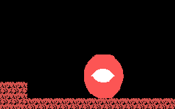

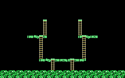

Vencido (lugares 0 a 3, `suceso_vencido` 0x8393): la m&uacute;sica 7, los y&#333;kai fuera, el dibujo borrado y dos
sprites (0xAC y 0xB0) que suben y se van; despu&eacute;s el lugar se acaba (`sala_acabada`, 0xAF73): el aguante se
llena y empieza el siguiente.

**Grabado en openMSX, FORZADO** (`tools/guiones/jefes.tcl`): con las teclas del t&iacute;tulo, cada lugar puesto a
mano y F1, 0xE046 puesto a mano y el protagonista llevado a la pantalla del suceso, entrando por su lado como al llegar
andando. Despu&eacute;s juega un piloto hecho para los sucesos: anda hasta una X, mira a la derecha, tira el arma cada
16 cuadros y salta cada 50. Vence el del lugar 1 (diez golpes en unos 3.000 cuadros); los dem&aacute;s no, en 4.000
cuadros cada uno: en el 0 y el 2 el protagonista tiene que estar m&aacute;s alto que el suelo (Y 0x98), en el 3 le da
una vez a la pupila y en el 4 ninguna.

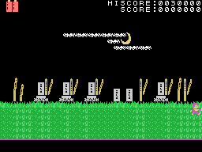

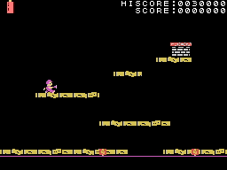

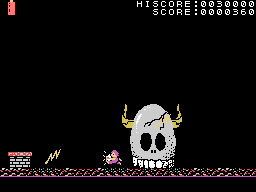

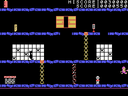

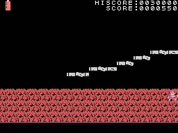

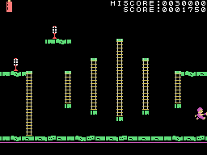

## El final

Vencer el suceso del lugar 4 no acaba el lugar: pone 0xE047 = 1 y suena la m&uacute;sica 7. El final est&aacute; en
otra pantalla, la **0x3C** (fila 3, columna 8 del plano del lugar 4), a la que se llega cayendo por el pozo de la
0x3B. Su lista (0x4EBE) lleva el &uacute;nico y&#333;kai del tipo 0x0B, **una chica** (0xA778), que solo sale con:

- 0xE047 puesto (el suceso del lugar 4 vencido);
- los objetos de los tipos 4 y 5 cogidos (0xE048 y 0xE049) y dos del tipo 6 (0xE04A = 2). **Esos objetos solo
  est&aacute;n en el sexto lugar** (pantallas 0x45 a 0x49: el tipo 4 en la 0x45 y la 0x49, el 5 en la 0x47, el 6 en
  la 0x46 y la 0x48), el que no est&aacute; en el camino de los dem&aacute;s, al que llevan las puertas 28 a 32 (ver
  arriba).

Entonces sale por la izquierda (X 0x10, Y 0x80) y el protagonista ya no se puede mover (0xE047 = 2: `prota_mueve` y
`salto` no hacen nada); ella anda hacia la derecha, 0xE8/0xEC y 0xF0/0xF4 cada 8 cuadros. Cuando llega a menos de 12
puntos de &eacute;l (y &eacute;l est&aacute; de pie en la Y 0x80), los dos se quedan quietos frente a frente y sale
dos veces **めでたし！** (*medetashi*, "y fueron felices", el cierre de los cuentos japoneses: 0xA839 y 0xA846, 13 + 13
casillas, en las filas 6-7 y 9-10), con la m&uacute;sica 3. Al acabar, el lugar se acaba (0xE186 = 2): la pantalla se
cierra, la vuelta sube (0xE009) y, con 0xE047 = 2, `sala_empieza` empieza **otra partida** desde el lugar 0
(`partida_va`, 0x7FB7): tres vidas, los objetos a cero, pero **los puntos se quedan**; con la vuelta a 1 los fantasmas blancos salen a veces en
azul claro, y desde la vuelta 2 en rojo claro (ver [Los sprites](LOS-SPRITES.html)).

**Grabado en openMSX, FORZADO** (`tools/guiones/final.tcl`): con las teclas del t&iacute;tulo, el lugar 4 puesto a
mano y F1; despu&eacute;s 0xE047 = 1, los cuatro objetos como cogidos y la pantalla 0x3C, entrando por arriba como por
el pozo. No se toca nada m&aacute;s: el protagonista cae al suelo, sale la chica, anda hasta &eacute;l y lo dem&aacute;s
es el juego.

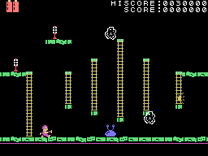

## Los lugares, forzados

Los GIF de los lugares 1 a 4 son **forzados**: el lugar puesto a mano (0xE00A) y F1, con lo que el protagonista cae
y el lugar empieza otra vez, ya el nuevo. Juega el piloto con las teclas del t&iacute;tulo.

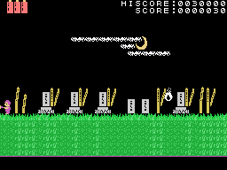

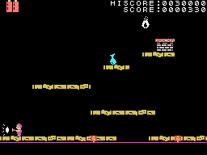

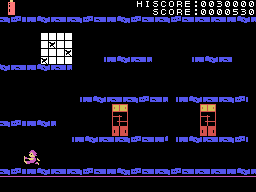

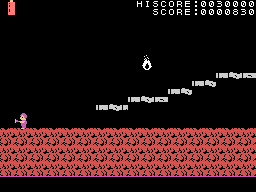
