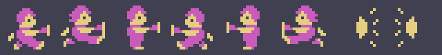
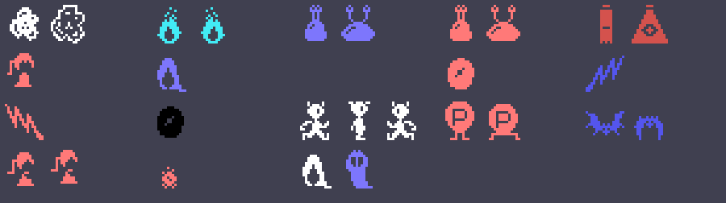
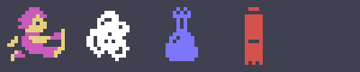
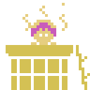
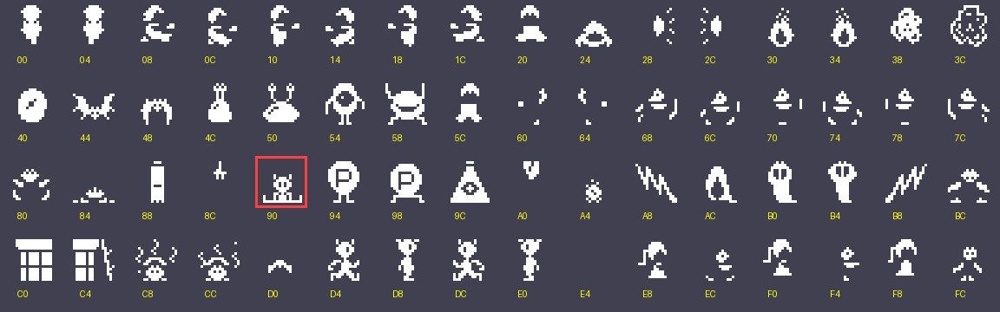

# Los sprites

Todo lo de esta página está **montado desde las tablas de la ROM** con `tools/hojas.py`: los dibujos son los 0x800
bytes de 0x5800 que `sprites_dibujos` (0xB36D) pone tal cual en 0x3800, y cada figura se arma con los dibujos y los
colores que le da el código. Cada cosa son sprites de 16 bytes desde 0xE300 (los 4 primeros, sus atributos): el
protagonista en 0xE300 y 0xE310, su arma en 0xE320 y los doce enemigos desde 0xE340 (+4 el tipo, por la tabla de
0xA1E8). Ninguna de estas imágenes es una captura.

**Cotejado con openMSX** en las grabaciones de esta web:

- la tabla de dibujos de los sprites (VRAM 0x3800-0x3FFF) es **idéntica** a la del juego en 35.858 cuadros (otros 4
  pillan la copia a medias);
- los dos sprites del protagonista, en el mismo sitio con el dibujo y el dibujo + 0x60 en amarillo claro, en
  **26.999 cuadros, 0 distintos** (otros 123 aún a cero);
- el arma, 0x28 o 0x2C, en **13.221 cuadros, 0 distintos**;
- los enemigos llevan uno de los dibujos (o el siguiente, + 4) y uno de los colores que les da su código en 14.615
  cuadros; **11 sin explicar**. Las rutinas de los enemigos no tienen nombre en el listado, así que este cotejo no va
  tipo a tipo.

## El protagonista y su arma

Dos sprites en el mismo sitio: el dibujo en magenta y el dibujo + 0x60 en amarillo claro (`sala_empieza` 0x806D,
`caida_para` 0x87A3). De pie 0x0C o 0x14 según su lado (0x880D), y andando de 0x08 a 0x1C. Después el arma
(`ataque_sale`, 0xE320): 0x28 a la derecha y 0x2C a la izquierda, que sale a 4 puntos por cuadro:

## Los fantasmas

Los dibujos y colores que las rutinas de los enemigos (0xA216-0xAD85) ponen en su sprite, cada uno con el siguiente
(+ 4) cuando lo cambian: 0x38 / 0x3C en blanco mientras esperan (0xA216), 0x30 en cian (0xAAE8), 0x4C en azul claro o
rojo claro (0xA451, 0xA457), 0x88 y 0x9C en rojo oscuro (0xA4E3), 0xF8 en rojo claro (0xA7A3), 0xAC en azul claro
(0xAB20), 0xE4 en amarillo claro (0xABE9: es un dibujo **vacío**, no se ve), 0x40 en rojo claro (0xABF9) o
negro (0xAD81), 0xB8 en azul oscuro (0xAC18), 0xA8 en rojo claro (0xAC90), 0xD4-0xE0 en blanco (0xA884), 0x94 en rojo
claro (0xA60A), 0x44 en azul oscuro (0xA770), 0xE8 y 0xF0 en rojo claro (0xA7AB) y 0xA4 en rojo claro, el segundo
sprite del de 0xD4 (0xA91B); al final, los dos que salen al vencer una sala (`suceso_vencido`: 0xAC y 0xB0):

El protagonista andando y algunos fantasmas con sus dos dibujos, al ritmo del juego:

## La pausa

STOP para el juego (`pausa`, 0x8145): guarda los sprites (en 0xE1C0) y pone cuatro en su sitio, en color 10: 0xD0 y
0xC8 encima del protagonista, 0xC0 y 0xC4 a su altura, uno a cada lado; arriba, 0xC8 y 0xCC se turnan cada 8 cuadros
(0x80E1). Con otro STOP vuelven los de antes. Grabado en openMSX (`tools/guiones/pausa.tcl`), sin forzar nada:

## Los 64 dibujos

La tabla de dibujos entera (los 0x800 bytes de 0x5800), en orden, con su número. **Todos los pone algún código menos
uno, el 0x90** (enmarcado en rojo): ninguna instrucción del cartucho lo escribe en un sprite. El 0xE4 está vacío y sirve
para esconder.

| dibujos | qué es | dónde lo pone |
|---|---|---|
| 0x00, 0x04, 0x60, 0x64 | el protagonista de espaldas, subiendo o bajando (el dibujo según su Y) | 0x8A04, 0x8A09 |
| 0x08, 0x0C, 0x10, 0x14, 0x18, 0x1C, 0x68, 0x6C, 0x70, 0x74, 0x78, 0x7C | el protagonista de pie, andando y saltando (y el + 0x60, su segundo color) | 0x8EF3, 0x880D, 0x8A9F, 0x8819, 0x8C2F, 0x8EFC, 0x8EF7, 0x8811, 0x8AA7, 0x881D, 0x8C37, 0x8F00 |
| 0x20, 0x80, 0x5C, 0xBC | el protagonista al perder una vida, una pareja y la otra cada 4 cuadros | 0xAE50, 0xAE54, 0xAE5A, 0xAE5E |
| 0x24, 0x84 | el protagonista tocado | 0x8BFC, 0x8C00 |
| 0x28, 0x2C | el arma, a la derecha y a la izquierda | 0x860B, 0x8615 |
| 0x30, 0x34 | un fantasma en cian | 0xA32A |
| 0x38, 0x3C | los fantasmas mientras esperan | 0xA222 |
| 0x40 | un fantasma en rojo claro o negro | 0xABF9 |
| 0x44, 0x48 | un fantasma en azul oscuro | 0xA76D |
| 0x4C, 0x50 | un fantasma en azul claro o rojo claro | 0xA45B, 0xA4BC |
| 0x54, 0x58 | el enemigo del tipo 7 andando | 0xA601, 0xA68C |
| 0x88, 0x8C, 0x9C, 0xA0 | un enemigo de dos sprites, en rojo oscuro | 0xA4E3, 0xA4E7, 0xA593, 0xA597 |
| 0x94, 0x98 | los demás enemigos de esa rutina, andando, en rojo claro | 0xA606, 0xA68C |
| 0xA4 | el segundo sprite del de 0xD4, en rojo claro | 0xA917 |
| 0xA8 | un fantasma en rojo claro | 0xAC90 |
| 0xAC, 0xB0 | un enemigo de dos sprites, en azul claro y blanco; y los dos que salen al vencer una sala (0x83AD) | 0xAB20, 0xAB24 |
| 0xB4 | con 0xB0, el que parpadea cada 8 cuadros (`suceso_parpadea`) | 0x831F |
| 0xB8 | un fantasma en azul oscuro | 0xAC18 |
| 0xC0, 0xC4, 0xC8, 0xCC, 0xD0 | el marco de la pausa (arriba) | 0x816F, 0x8173, 0x816B, 0x80E9, 0x8167 |
| 0xD4, 0xD8, 0xDC, 0xE0 | el fantasma blanco de 0xA884, también en su salto | 0xA9F7 |
| 0xE4 | **vacío**, no se ve: se lo pone a un enemigo (0xABE9) y a los cuatro sprites del protagonista (0x95FC) | 0xABE9 |
| 0xE8, 0xEC, 0xF0, 0xF4 | un enemigo de dos sprites, en rojo claro y amarillo claro | 0xA7D0, 0xA7D5 |
| 0xF8, 0xFC | el mismo enemigo, con otros dos dibujos | 0xA7A3, 0xA7A7 |
| 0x90 | **sin uso**: ningún código lo pone | — |
